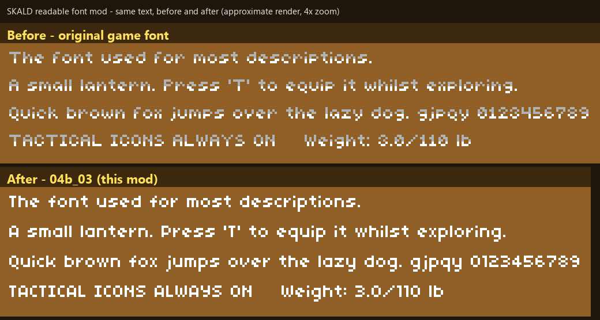

# SKALD – Readable Font Mod (04b_03)

Replaces the small UI text font of **SKALD: Against the Black Priory** with **04b_03**: rounder, evenly weighted letters that are easier to read. Same glyph height and line spacing as the original, so the UI layout does not shift.

*Approximate render built from the game's own font data, 4× zoom – not an in-game screenshot.*

## Install (Windows – nothing to install)

1. Download **`SKALD-Font-Patcher.exe`** from [Releases](../../releases/latest).
2. Close the game and run the exe. Choose **`1`**.
3. Start the game.

**Undo:** run it again and choose **`R`**.

It finds the game automatically (default GOG / Steam folders). If not, paste the game folder when asked, or run `SKALD-Font-Patcher.exe --apply --game "D:\Games\SKALD"`.

## Compatibility

Works on **any game version**: it edits the font atlases inside `resources.assets` by structure, not by checksum. If the atlases do not have the expected layout it refuses and changes nothing. A backup (`resources.assets.original`) is made first. After a game update, use the store's *Verify / Repair* and run the patcher again.

Tested on the GOG build "Launch 1.0.5" (the only one I have). Reports for other builds / Steam are welcome – open an Issue.

## Notes

- Glyphs are drawn in **one solid colour** (the original font shades the upper half grey, which hurts readability). Want the original shading back? Run with `--two-tone`.
- Only the **small** text is changed; the large gothic titles and the Medium/Big fonts are not.
- English text only (no translation).
- The exe is **unsigned**, so SmartScreen or an antivirus may warn. Everything is open source: run the same code with Python instead – `pip install UnityPy`, then `python src/patch_font.py --apply`. Release notes list the exe's SHA-256.

## Credits & licence

- Font **04b_03** by Yuji Oshimoto ("04"). Its licence is **not verified** – see [NOTICE.md](NOTICE.md); contact me via an Issue to have it removed.
- Code: MIT ([LICENSE](LICENSE)). Unofficial fan mod, not affiliated with High North Studios. Use at your own risk.

---

## Tiếng Việt (tóm tắt)

Mod đổi font chữ **nhỏ** của SKALD sang **04b_03** (dễ đọc hơn, giữ nguyên cỡ chữ và bố cục).

1. Tải **`SKALD-Font-Patcher.exe`** ở mục [Releases](../../releases/latest).
2. Đóng game, chạy file, chọn **`1`**, rồi mở game.
3. Gỡ mod: chạy lại và chọn **`R`**.

Không cần cài thêm gì và **không khoá theo một phiên bản game** (sửa theo cấu trúc file, không theo mã kiểm tra). Phiên bản lạ không đúng cấu trúc thì công cụ từ chối và không sửa gì. Có sao lưu `resources.assets.original`. Chỉ đổi chữ nhỏ; tiêu đề lớn giữ nguyên. File exe chưa ký số nên có thể bị cảnh báo; mã nguồn mở, có thể chạy bằng Python (`python src/patch_font.py --apply`).
